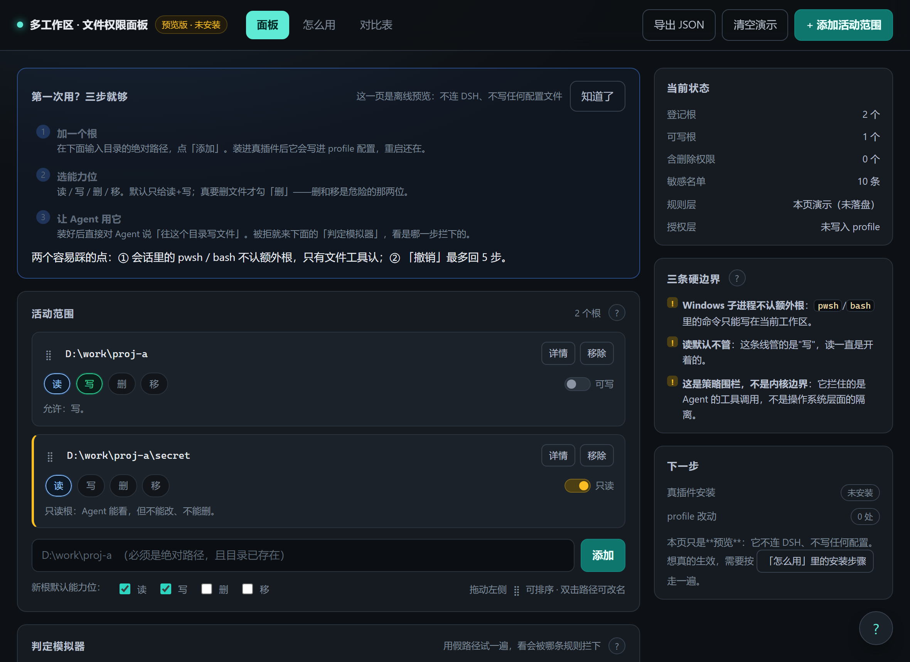

# dsh-multi-workspace

<p>
  <a href="https://www.npmjs.com/package/dsh-multi-workspace"></a>
  <a href="https://www.npmjs.com/package/dsh-multi-workspace"></a>
  <a href="https://github.com/David-Martinez-worldexecute/dsh-multi-workspace/actions/workflows/ci.yml"></a>
  
  
  
  
</p>

**Agent 能写你的文件。但你能一眼说出它刚才动过哪儿、被谁允许的吗？**

给 DSH 的 Agent 添加额外可写根，并且**每个根单独规定「读 / 写 / 删 / 移」**。
真正不一样的地方是：每次放行和拒绝都进 JSONL 审计，面板把边界翻译成一句人话——
「该根有写权限但**无**删权限；`.env` 已被敏感名单拦截」——你不用翻日志就能判断边界合不合理。

**安装（一条命令）**

```bash
npx -y @deepseek-ai/dsh plugin --profile desktop add dsh-multi-workspace
```

重启 DSH 生效——会话输入框左边出现「根 N」胶囊即安装成功。
需要 Node ≥ 20、DSH ≥ 0.2.2-rc.3；本地开发和回滚见 [§6 安装](#6--安装--installation)。

_English — Extra writable roots for DSH agents, with per-root capability bits and a JSONL audit
trail. The point is legibility: a denial names the rule that blocked it. No kernel patches._



<p align="center"><sub>面板长在会话输入框左侧，点开即用；离线演示见 <a href="panel/preview.html">panel/preview.html</a></sub></p>

## 快速开始 · Quick start

装好之后，点会话输入框左边的 **「根 N」** 胶囊；面板第一屏就是三步引导，关掉以后点右上角 **?** 能再看一遍。

1. **加一个根** —— 粘贴一个绝对路径（例如 `D:\work\proj-a`），选能力位（读 / 写 / 删 / 移），按「添加」。<br>_Add a root: paste an absolute path, pick capabilities, hit Add._
2. **确认它生效** —— 顶部「持久根」列表出现这一行；想反悔按「撤销」（最多回 5 步）。<br>_Verify: the row shows up; Undo reverts up to 5 steps._
3. **让 Agent 用它** —— 直接说「在 `D:\work\proj-a` 下新建 `x.py`」；被拒时会告诉你哪条规则拦的、为什么。<br>_Use it: just ask the agent to write there; denials name the rule and the reason._

最短安装路径（真机验证过的四步）见 [§6 安装](#6--安装--installation)。

### ⚠️ 三条边界，先看清 · Three boundaries first

| # | 边界 | Boundary |
| --- | --- | --- |
| 1 | 文件工具（`write` / `edit` / `patch` / `delete` / `move` / `ops_*` / Office）**认**额外根 | File tools honour extra roots |
| 2 | `pwsh` / `bash` **子进程不认**额外根，只认工作区 + 私有 temp | Shell subprocesses do **not** (DSH 0.2.2-rc.3 limitation) |
| 3 | 读本来就全放开，本项目只管**写** | Reads are unrestricted; this project governs **writes** |

这不是"没做完"，是 `dsh-pwsh-sandbox` 只把 workspace root 与私有 temp 交给子进程。

## 目录 · Table of contents

| 章节 | Section |
| --- | --- |
| [1 · 它解决什么问题](#1--它解决什么问题--why-this-exists) | Why this exists |
| [2 · 三层架构](#2--三层架构--architecture) | Architecture |
| [3 · 规则格式](#3--规则格式--rule-format) | Rule format |
| [4 · 两种用法](#4--两种用法--two-ways-to-use) | Two ways to use |
| [5 · 工具 API](#5--工具-api--tool-api) | Tool API |
| [6 · 安装](#6--安装--installation) | Installation |
| [7 · 自检](#7--自检--self-check) | Self-check |
| [8 · 边界与安全](#8--边界与安全--boundaries--security) | Boundaries & security |
| [9 · 项目结构](#9--项目结构--project-layout) | Project layout |
| [10 · 面板](#10--面板--the-panel) | The panel |
| [11 · 实现对应](#11--实现对应--internals) | Internals |
| [12 · 踩坑记录](#12--踩坑记录--pitfalls-from-real-installs) | Pitfalls |
| [13 · 兼容性](#13--兼容性--compatibility) | Compatibility |
| [14 · 贡献](#14--贡献--contributing) | Contributing |
| [15 · 安全](#15--安全--security) | Security |
| [16 · 版本与发布](#16--版本与发布--releases) | Releases |
| [17 · 许可证](#17--许可证--license) | License |
| [18 · 致谢](#18--致谢--acknowledgements) | Acknowledgements |

---

## 1 · 它解决什么问题 · Why this exists

DSH 默认只有**一个**工作区。换个项目写个文件就会被围栏拦下来，提示 `[sandbox: file access denied under workspace-write mode]`。

内核其实早就有"多根"的底层能力，缺的是**给人用的入口**和**按路径的细分权限**：

| 需求 | 内核现状 | 本项目 |
| --- | --- | --- |
| 加多个可写目录 | 有 `additionalWritableRoots`（部署级）+ `registerWritableRoot(session, dir)`（单会话） | 一句话添加、增删、列出、持久化 |
| 不再只有三档（read-only / workspace-write / danger-full-access） | 只有三档 | 每个根自带 `read/write/delete/move` 四能力位 + `ro` 只读标记 |
| 按文件/子目录细分 | 围栏是**按根**的，一道围栏管五种写操作 | 根内 `include`/`exclude` 的 glob 子规则 |
| 保护 `.env` / `*.pem` / `id_rsa` | 无 | 敏感名单**优先于**根匹配，命中即拒 |
| 事后能查"谁被拒了、为什么" | 审批不带参数、无记录 | JSONL 审计，超 5MB 轮转 |

## 2 · 三层架构 · Architecture

```
① 规则层   本项目拥有   profile 的 multi-workspace 行（roots / shell / sensitive / audit）
② 授权层   DSH 拥有     profile 的 additionalWritableRoots（告诉沙箱"这些目录可写"）
③ 执行层   DSH 拥有     文件沙箱与 ACL runner（本项目一行都不改）
```

**为什么要分三层**：权限判定是我们的事，落盘拦截是内核的事。混在一起就会出现"规则说能写、沙箱还是拒"的假象 —— 因为真正让步的是第 ② 层。

`sync` 只做"把规则层算出来的根写进授权层"，并且**必须**整行重述（DSH 的 patch 是整行替换，只写一个键会把 `mode`/`workspaceRoot` 弄丢）。

## 3 · 规则格式 · Rule format

```yaml
roots:
  - path: D:\work\proj-a
    capabilities: [read, write, delete, move]
    mode: rw
  - path: D:\work\proj-a\secret
    capabilities: [read]          # 子目录只读：最长前缀优先，不会被上面那个根放行
  - path: E:\scratch
    capabilities: [read, write]
    mode: rw
    expiresAt: 1767225600000      # 临时授权，过期即拒
shell:
  mode: deny                      # deny（默认）/ allowlist
  allowlist: []                   # 只认"命令全等"，不认前缀
sensitive:
  deny: ['.env', '*.pem', 'id_rsa', '.ssh/**', '.dsh/**']
audit:
  enabled: true
  file: .dsh/multi-workspace-audit.jsonl
```

判定顺序（写死在 `src/rules.mjs` 的 `resolve`）：

1. 不认识的工具 → 放行（不碰别人的工具）
2. shell 类 → 按 `shell.mode`
3. 抽不到路径 → 放行
4. 全局 `read-only` 且非读 → 拒
5. 读且没开 `enforceRead` → 放行（DSH 本来不围栏读）
6. **敏感名单** → 拒（先于根匹配）
7. 最长前缀找根 → 找不到：`PATH_OUTSIDE_SCOPE`
8. 过期 → `GRANT_EXPIRED`
9. `exclude` → `EXCLUDED_PATH`
10. `include`（非读）→ `NOT_INCLUDED`
11. `ro` 且非读 → `READ_ONLY_ROOT`
12. 没有该能力位 → `CAPABILITY_DENIED`

## 4 · 两种用法 · Two ways to use

### A. 本地控制台（零依赖，不装进 DSH 就能用）

```bash
node bin/mw.mjs list
node bin/mw.mjs add "D:\work\proj-a" --caps read,write --mode rw
node bin/mw.mjs add "E:\scratch" --caps read --expires 1767225600000
node bin/mw.mjs remove "E:\scratch"
node bin/mw.mjs validate "D:\work\proj-a"      # 只校验不写
node bin/mw.mjs probe "D:\work\proj-a"         # 真写一个临时文件再删
node bin/mw.mjs diff                            # 规则层 vs 授权层差多少
node bin/mw.mjs status
```

规则优先写进 profile 的配置行；写不进去时落到工作区内的兜底文件 `.dsh/multi-workspace-rules.json`（面板会明说这次落在哪）。`diff` 会读 profile 的 `cordis.patch.yml`，扫不到 `additionalWritableRoots` 时如实说"没有这一段"，而不是假装"已经一致"。

### B. 装进 DSH（模型自己用 `workspace_roots` 工具）

见第 6 节。**这一步会改 profile，需要你拍板。**

## 5 · 工具 API · Tool API

工具名 `workspace_roots`，一个入口多个动作：

```json
{ "action": "list" }
{ "action": "add", "path": "D:\\work\\proj-a", "capabilities": ["read","write"], "mode": "rw" }
{ "action": "add", "path": "E:\\scratch", "expiresAt": 1767225600000 }
{ "action": "remove", "path": "E:\\scratch" }
{ "action": "update", "path": "D:\\work\\proj-a", "capabilities": ["read"] }
{ "action": "validate", "path": "D:\\work\\proj-a" }
{ "action": "probe", "path": "D:\\work\\proj-a" }
{ "action": "status" }
{ "action": "sync", "dryRun": true }
{ "action": "audit", "limit": 20 }
{ "action": "evaluate", "toolName": "write", "argsJson": "{\"file_path\":\"D:\\\\work\\\\proj-a\\\\x.txt\"}" }
{ "action": "doctor" }
{ "action": "undo" }
{ "action": "export" }
{ "action": "import", "json": "{\"version\":2,\"roots\":[...]}" }
{ "action": "session-add", "path": "E:\\scratch", "sessionId": "<会话 id>", "ttlMinutes": 60 }
{ "action": "session-list", "sessionId": "<会话 id>" }
{ "action": "session-remove", "path": "E:\\scratch", "sessionId": "<会话 id>" }
```

- `add/remove/update/sync/probe` 属于**变更类**，默认必须过审批；没有审批通道时返回 `APPROVAL_UNAVAILABLE` 并**拒绝**（fail closed，绝不默认放行）。
- 返回值固定带 `subprocessHonored: false` 与人话说明，免得模型以为 `pwsh` 也认这些目录。
- 默认**不管读**（`enforceRead: false`）。管了会先把"看日志、看 asar、看别人的配置"这些正常操作弄坏。
- `evaluate` **只判不执行**：拿工具名 + 参数问"会不会被放行"，用来排查"为什么这次写被拒了"。
- `session-*` 是**会话级临时根**：走 `ctx.sandboxPolicy.registerWritableRoot(session, dir)`，只对那一场会话生效、不写配置、不继承 subagent，`ttlMinutes` 到点自动撤销。
- `undo` 最多回退 5 步；`export`/`import` 是整份规则文档往返（导入要过审批）。

## 6 · 安装 · Installation

> v0.5.4 起推荐一条命令。旧版教的「改 profile JSON + `mklink` + `set_bundle`」仍然有效，但只用于**本地开发**（改代码即时生效），见 6.2。
>
> 历史教训保留：手工往 `cordis.patch.yml` 加 `- id: multi-workspace` 是错的 —— 行 id 必须等于包名
> `dsh-multi-workspace`，否则 `configEditor.edit` 报 `Configuration entry is no longer available`。

### 6.1 一条命令（推荐）

```bash
npx -y @deepseek-ai/dsh plugin --profile desktop add dsh-multi-workspace
```

- 它会自动建/复用 profile、`pnpm add` 装包，并把包名登记进该 profile 的 `dsh.profile.bundles`；
  **装包与「被 DSH 选中」一次完成** —— 不用手改 JSON、不用 `mklink`、不用再调 `plugin_manager`。
- `--profile` 换成你自己的 profile 名（`~/.dsh/profiles/` 下的目录名，桌面版通常就是 `desktop`）。
- 前置：`npx`（Node ≥ 20）与 `pnpm`（`dsh plugin` 会把参数转发给 pnpm）。
- 重启 DSH 生效；验收见 6.4。

### 6.2 本地开发安装（link + junction，改代码即时生效）

```bash
cd ~/.dsh/profiles/desktop

# 1) package.json 的 dependencies 加一行（请换成你 clone 下来的仓库绝对路径）
#    "dsh-multi-workspace": "link:<你的仓库路径>"

# 2) 同一个 package.json 的 dsh.profile.bundles 数组里加一个 "dsh-multi-workspace"

# 3) 建 junction（Windows 用 mklink /J；不要复制目录，也不要用 Remove-Item -Recurse 删它）
cmd /c mklink /J node_modules\dsh-multi-workspace "<你的仓库路径>"
```

### 6.3 让 DSH 真的加载它（缺这一步就是「装了但没界面」）

只改 `package.json` 不够 —— bundle 还要被「选中/启用」：

```
plugin_manager action=set_bundle target=dsh-multi-workspace enabled=true
```

- 返回 `"application":"applied"` 才算加载成功；
- 返回 `"application":"failed"` 时，`error.diagnostic` 会写明哪一行没激活。我们真撞过的两种：
  `cannot get property "configEditor" without inject`（服务没 inject 就读）
  与 `tool "workspace_roots" must declare output { schema, render }`（工具声明不全）。
- 客户端 bundle 与节点侧是**两条链**：面板能显示不代表服务端加载了。

### 6.4 验证（30 秒，别猜）

```bash
# 1) 服务端路由活着 → 200 + JSON
curl http://127.0.0.1:<你的端口>/plugins/dsh-multi-workspace/state

# 2) 404 但面板有胶囊 → 节点侧没加载（回去看 6.3 的 diagnostic）

# 3) 输入框左侧出现「根 N」胶囊 → 客户端也通了
```

### 6.5 回滚

1. `plugin_manager action=set_bundle target=dsh-multi-workspace enabled=false`
2. 删 `dependencies` 那行与 `dsh.profile.bundles` 里的名字
3. `cmd /c rmdir node_modules\dsh-multi-workspace`（junction 用 rmdir）
4. 重启 DSH

规则留在 profile 配置行里，写不进去时在 `.dsh/multi-workspace-rules.json`；审计日志在
`.dsh/multi-workspace-audit.jsonl`。两者都不影响 DSH 启动，可以随时删。

## 7 · 自检 · Self-check

```bash
node tests/run-all.mjs     # 期望：tests 217 / pass 217 / fail 0
node bin/mw.mjs list       # 期望：一句人话，不是空表格
node bin/mw.mjs diff       # 期望：如实报告授权层现状
```

为什么不用 `node --test`：DSH 的 workspace-write 沙箱里测试运行器要 `spawn` 子进程，会直接 `Error: spawn EPERM`（一条用例都没跑，报成 `tests 1 fail 1`）。`run-all.mjs` 用**同进程 import** 跑全部用例。

## 8 · 边界与安全 · Boundaries & Security

| # | 边界 | 会不会补 |
| --- | --- | --- |
| 1 | **Windows 子进程不认额外根**：`pwsh`/`bash`/`python`/`node` 里的写操作仍被围到 workspace + 私有 temp | 不补。要真正打通得给额外根打 ACL，属高风险且需要管理员，默认不做 |
| 2 | shell 命令的路径藏在字符串里，守卫看不到真实目标 | 默认 `shell.mode: deny`；开白名单也只认"命令全等"（`git status && del x` 绕不过去） |
| 3 | 读不受管（默认） | 需要时 `enforceRead: true`，但会先影响"看日志/看 asar"这类正常操作 |
| 4 | 会话级根（`registerWritableRoot`）不持久、不继承 subagent | 需要持久就用授权层（profile） |
| 5 | 撤销授权后，**已在跑**的进程保持旧权限 | 起新进程才生效 |
| 6 | 沙箱是**策略围栏**，不是内核边界（残留 TOCTOU 已被缩小但没消除） | 上游的事 |
| 7 | 审批**不携带工具参数**（`dsh-user-approval` 原文），所以审批弹窗看不到路径 | 这是为什么路径判定必须放在 guard 里，而不是指望人点"允许"时能看见路径 |
| 8 | 守卫管不到 shell 里的删除/移动 | 同第 2 条 |
| 9 | `sandbox-policy` 行 id 未在 base 里确认 | 安装步骤已标注"按 edit 报错处理，不要猜" |
| 10 | **面板的写操作不过工具审批** | 审批是给"模型发起的工具调用"的；点面板的是人本人，人本身就是授权来源。模型想改规则仍走 `workspace_roots` + 审批 |
| 11 | `/plugins/<包名>/...` **不经过** session cookie 校验 | 所以每条路由都必须自己做"只收本机回环 + Origin 与 Host 同源"两道检查；漏一条就是局域网里谁都能改你的可写根 |
| 12 | **面板不显示 ≠ 插件没加载** | 先用 `curl .../plugins/dsh-multi-workspace/state` 分辨：404 = 服务端没挂；200 但没有胶囊 = 客户端 bundle/槽位问题 |

## 9 · 项目结构 · Project layout

| 文件 | 作用 |
| --- | --- |
| `src/paths.mjs` | 路径判定的**唯一来源**（canonical / keyOf / withinOf / glob / 抽路径） |
| `src/rules.mjs` | 纯规则引擎：`resolve()` 十二步判定，不碰配置与沙箱 |
| `src/validate.mjs` | 收根校验：形态、存在、symlink、deny-list、重复、覆盖 |
| `src/guard.mjs` | V1 兼容层：`createGuard` / `decide`，内部转调 `rules.resolve` |
| `src/store.mjs` | 规则文档的读写 + 授权层同步计划（落盘全走 `ctx.configEditor.edit`） |
| `src/tool.mjs` | 模型入口 `workspace_roots` |
| `src/audit.mjs` | JSONL 审计 + 5MB 轮转（**参数只记形状不记值**） |
| `src/cli.mjs` + `bin/mw.mjs` | 本地控制台（不依赖 DSH 运行时） |
| `src/index.mjs` | DSH 插件入口（唯一依赖真实 DSH API 形状的文件） |
| `panel/preview.html` | 1360 行可视化预览：第一次使用的三步引导卡 + 可点/可拖/可改名 + 判定 12 步可视化 + 二级说明页（8 条 FAQ）+ 根的能力对比表；不连 DSH、不写配置 |
| `src/http.mjs` | 面板的本机接口：`GET /plugins/dsh-multi-workspace/state`、`POST .../roots`（回环 + 同源双闸） |
| `lib/client.js` | 浏览器端 bundle：输入框左侧「根 N」胶囊 + 弹层（手写，不经打包器） |
| `tests/http.test.mjs` | 路由守卫与写入行为（403 两道闸、add/remove/update、坏 JSON） |
| `tests/client.test.mjs` | 用 `vm` + 假 React 真跑一遍 bundle：id 对包名、`apply` 挂对槽位、无 ESM 语句 |
| `tests/store.test.mjs` | 规则文档读写、授权层 diff、撤销栈、导入导出（假 configEditor） |
| `tests/tool.test.mjs` | 工具面：审批闸、evaluate/doctor/undo/import/session-* |
| `tests/run-all.mjs` | 同进程聚合跑 217 条用例（含面板结构守卫 `panel.test.mjs`、仓库形状守卫 `docs.test.mjs`） |
| `LICENSE` / `CHANGELOG.md` / `SECURITY.md` | 开源三件套（安全模型写在 `SECURITY.md`） |
| `.github/workflows/ci.yml` | CI：语法检查 + 全量测试 + 装前自检 + CLI 冒烟 |

## 10 · 面板 · The panel

装进 profile 并**重启**之后，对话输入框左侧（自动继续开关那一条的最左边）会出现一个「根 N」小胶囊：

- 点开：列出额外活动范围，点圆片切「读/写/删/移」，开只读，移除，输入路径添加；
- 数据走 `GET/POST /plugins/dsh-multi-workspace/...`，不直接碰配置文件；
- 写入会落进 profile 的 `cordis.patch.yml`（规则层），并留一条审计；
- 改完对**下一个**模型请求生效；已经在跑的子进程保持旧权限。

三条必须记住的：

1. 面板的写操作**不过工具审批**（人点的是人本人）；模型改规则仍然要走 `workspace_roots` 工具 + 审批。
2. 这些路由**不经过** session cookie，所以服务端自己做了回环 + 同源检查 —— 这也是为什么它只在本机浏览器里可用。
3. 面板不显示时，先用 `curl http://127.0.0.1:<端口>/plugins/dsh-multi-workspace/state` 分辨是"服务端没挂"还是"客户端没挂"。

### 10.1 v0.5 面板新增了什么

| 能力 | 怎么用 | 注意 |
| --- | --- | --- |
| 自动刷新 | 打开面板即每 10 秒拉一次 `GET /state`，用 `rev` 短路：没变就不重绘 | 输入框里的字不会被刷掉 |
| 持久根 / 临时根分区 | 面板分两块；「加临时根」只在当前会话有效 | 临时根需要浏览器侧传 `sessionId` |
| 三个预设 | 每条根后面：只读浏览 / 项目协作 / 含删除 | 只改这一条根，不做批量 |
| 试算 | 「工具」页贴一段 `{"toolName":...,"args":...}`，点试算 | 只判不执行 |
| 最近记录 | 「工具」页拉最近 8 条面板操作 / 被拒记录 | 参数只记形状 |
| 撤销 | 「根」页底部「撤销」 | 最多 5 步，写失败的不进栈 |
| 导入导出 | 「工具」页导出到文本框 / 粘贴回来导入 | 导入会覆盖整份规则文档 |

## 11 · 实现对应 · Internals

| 功能 | 代码落点 | 判定/返回 |
| --- | --- | --- |
| 会话级临时根 | `src/index.mjs`（`registerSessionRoot` / `removeSessionRoot` / `disposeAllSessionRoots`） | `SESSION_ADDED` / `SESSION_UNAVAILABLE` / `POLICY_UNAVAILABLE` / `REGISTER_FAILED` |
| 试算 | `src/index.mjs` `evaluateCall` + `src/http.mjs` `POST /evaluate` | `{decision:'allow'|'deny', code, reason, matchedRoot}` |
| 自检 | `src/index.mjs` `doctorReport` | 8 个接线点，任一不过 → `DEGRADED` |
| 撤销 | `src/store.mjs` `undo` / `undoDepth` | `UNDONE` / `NOTHING_TO_UNDO` |
| 导入导出 | `src/store.mjs` `exportJson` / `importDoc` | `IMPORTED` / `BAD_DOC` |
| 面板事件流 | `src/http.mjs` `GET /events` | `{items:[{code,path,at}]}` |

### 11.1 开源前还差一步

仓库级的东西已经准备好了（`LICENSE`、`CHANGELOG.md`、`SECURITY.md`、`.gitignore`、CI）。**推上 GitHub 不是本地动作**：需要先建远端仓库、再加 `repository` 字段，然后由你决定是否 `git push`。本项目不做自动推送。

## 12 · 踩坑记录 · Pitfalls from real installs

这一节不是功能介绍，是「装上之后为什么没反应」的排障索引。每一条都在这台机器上真实发生过，现象和根因都在下面。

| 现象 | 真正的原因 | 现在的处理 |
| --- | --- | --- |
| 面板一直是 `HTTP 404`，但客户端 UI 正常显示 | `ctx.configEditor` / `ctx.workspaceRoot` 这类服务在 Cordis 里**先 inject 才能读**；直接读抛 `cannot get property "X" without inject`，异常打断**整个插件激活** | 统一走 `safeService()`，读不到就 `undefined`；每个实例往 `.dsh/load-trace.log` 写一行状态 |
| 点「加持久根」报 `Configuration entry is no longer available` | `rowId` 默认值是 `multi-workspace`，而 `cordis.patch.yml` 里的行 id 是 `dsh-multi-workspace` | 两处默认值统一；任何自定义行 id 必须与 patch 行 id 逐字相同 |
| 工具表里没有 `workspace_roots` | `tool "workspace_roots" must declare output { schema, render, presentationMeta? }` | 补 `output.schema` + `output.render` |
| 面板说「临时根用不了」、规则只能落兜底文件 | 可选服务的探测写成 `ctx[name]` 属性访问，而宿主在没 `inject` 时不把服务挂属性上 → `configEditor` / `sandboxPolicy` / `sessions` 永远是 `undefined` | 改成**优先 `ctx.get(name)`**（宿主 app.asar 自带文档的写法），属性访问只作兜底；热激活后 `persistVia` 与 `sessionRootsSupported` 立刻正常 |
| `persistVia: "config"` 但实际写的是兜底文件 | 服务在 ≠ 写进去了：profile 的 `cordis.patch.yml` 里没有本插件的行（bundle 的行住在插件自己包里，`configEditor` 不认它），`edit()` 抛 `Configuration entry is no longer available` | `persistVia` 报**默认落点**（`file`），原因写进 `status.notes`，不再声称写进了配置行 |
| 配置里写了 `allowShell: true`，命令还是被拒 | `resolve()` 从来没读过这个键 | `allowShell` 现在是总闸；不写就按 `doc.shell` 判 |
| 界面上只勾了「读+写」，实际能删能移 | 面板原来的 `add` 请求不带能力位，服务端按四个全给建档 | 请求带 `caps`；`/roots` 三个入口同时认 `caps` 与 `capabilities` |
| 面板「试算」说会被拒，工具实际却能跑（或反过来） | 守卫 `guard()` 与试算 `evaluateCall()` 是两个出口，后者漏传 `allowShell` —— 两边看到的世界不一样 | 两个出口用同一份参数；`tests/contract.test.mjs` 锁死「同一次调用必须同答案」 |

两条给后来者的提醒：

1. **插件"能显示"和"能干活"是两条独立的加载链**。客户端 bundle 走 `dsh.client` + `exports["./client"]`；服务端走 `cordis.patch.yml` 的 `- insert:` 行。客户端能渲染，完全不代表节点侧活着 —— 先 `curl /plugins/<包名>/state`，404 就是节点侧没起来。
2. **降级要留痕**。写配置失败时现在会退到 `.dsh/multi-workspace-rules.json`，并把 `via: 'file'` 一路透到面板上 —— 否则「保存成功」可能只是落在没人读的地方。

## 13 · 兼容性 · Compatibility

| 项目 | 要求 | Requirement |
| --- | --- | --- |
| DeepSeek Harness | `0.2.2-rc.3`（实测版本） | tested on 0.2.2-rc.3 |
| Node.js | `>= 20.0.0` | see `engines` in `package.json`（实测环境为 25.x；20–24 未逐一验证） |
| 系统 | Windows 10 / 11（`pwsh` 边界只在 Windows 上验证过） | Windows 10/11 |
| 运行时依赖 | **零**（只用 `node:` 内置模块） | zero runtime deps |

客户端 bundle 走 `dsh.client`（`platform: web`），服务端走 `dsh.bundle.patch`（Cordis 行插入）。两者都只在 DSH 启动 / 热激活时读，改完必须重启或 `plugin_manager set_bundle`。

## 14 · 贡献 · Contributing

欢迎 issue / PR。开始之前请读 [CONTRIBUTING.md](CONTRIBUTING.md)，它写清了本地怎么跑、提交信息怎么写、以及哪些改动会被拒（例如绕过 `tests/` 里已有的守卫）。

```bash
npm test                        # = node tests/run-all.mjs，必须全绿
npm run check                   # 测试 + load-check（真调 apply() 的加载自检）
node scripts/route-probe.mjs    # 假 ctx 跑一遍路由注册
```

最小可复现的 bug 报告模板见 [.github/ISSUE_TEMPLATE](.github/ISSUE_TEMPLATE)。

## 15 · 安全 · Security

策略栅栏，**不是内核边界**。它拦的是 Agent 的工具调用，不是操作系统层面的隔离。完整威胁模型、已知绕过与报告方式见 [SECURITY.md](SECURITY.md)。

三条必须知道的：

- `allowShell: true` 会让围栏**只剩文件工具这一层**（子进程本来就不受控）；
- 符号链接：围栏按字面路径判定，不解析 `realpath` 后的目标；
- 面板的写操作**不过工具审批** —— 审批是给"模型发起的调用"的，点面板的是人。

## 16 · 版本与发布 · Releases

版本遵循 [SemVer](https://semver.org/)，变更记录见 [CHANGELOG.md](CHANGELOG.md)。

```bash
git tag -a v0.5.2 -m "v0.5.2" && git push origin v0.5.2
gh release create v0.5.2 --title "v0.5.2" --notes-file CHANGELOG.md
```

## 17 · 许可证 · License

[MIT](LICENSE) © 2026 dsh-multi-workspace contributors

## 18 · 致谢 · Acknowledgements

架构与契约来自 DeepSeek Harness 本体（`@deepseek-ai/dsh-sandbox-policy`、`dsh-host-webserver`、Cordis 插件系统）；面板的插槽契约与若干踩坑结论，是从 `dsh-ai-memory`、`dsh-client-auto-continue` 这两个真实插件对照出来的。
